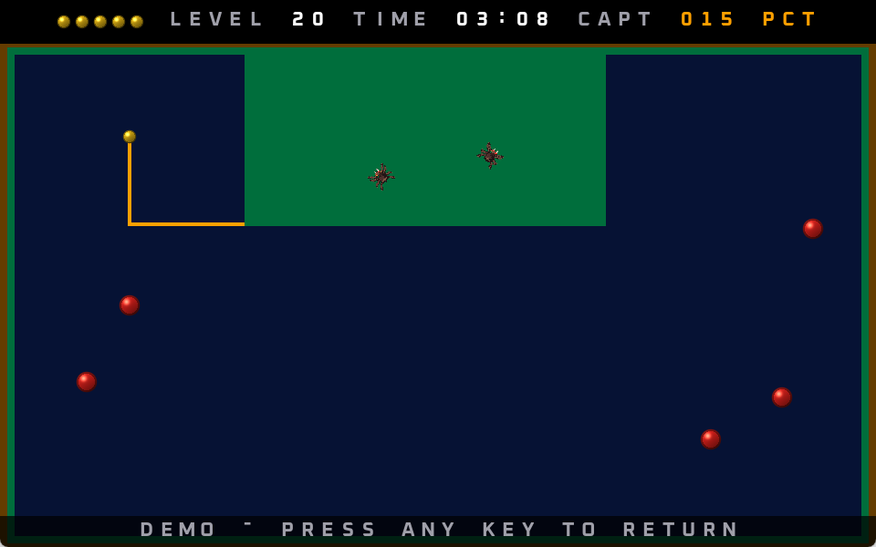

# xonix-sdl

A cross-platform remake of the classic arcade game Xonix, written in C11 and SDL3.
Compiles into a **single standalone executable** with embedded assets.

## Screenshots
<table>
  <tr>
    <td></td>
    <td></td>
  </tr>
</table>

## Features & Controls
* **Gameplay:** 21 levels, 5 lives, 75% territory goal, patrolling spiders, and local Top-10 high-scores.
* **Controls:** `Arrows` / `WASD` or Gamepad to move, `Enter` / `Space` to start, `F11` for fullscreen, `Esc` to quit. *(Tip: run `./xonix-sdl --level 7` to jump levels).*

## Quick Build
```bash
./build.sh              # Linux (default)
./build.sh windows      # Windows x86_64 (MinGW-w64)
./build.sh macos        # macOS (Homebrew SDL3)
```
*Manual CMake: `cmake -S . -B build -DCMAKE_BUILD_TYPE=Release && cmake --build build -j`*

## License
Licensed under the **MIT License**.
