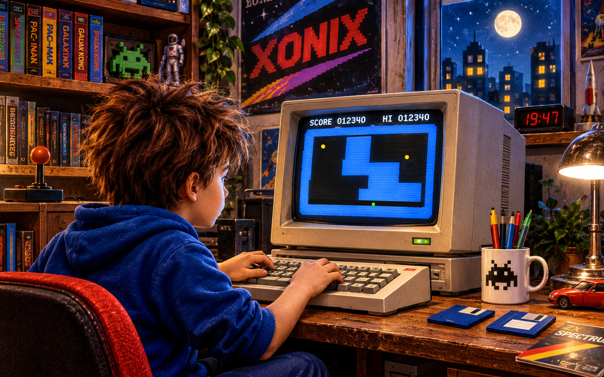

# xonix-sdl

A cross-platform remake of the classic arcade game Xonix, written in C11 and SDL3.
Compiles into a **single standalone executable** with embedded assets.

## Screenshots
<table>
  <tr>
    <td></td>
    <td></td>
  </tr>
</table>

## Features & Controls
* **Gameplay:** 21 levels, 5 lives, 75% territory goal, patrolling spiders, and local Top-10 high-scores.
* **Controls:** `Arrows` / `WASD` or Gamepad to move, `Enter` / `Space` to start, `F11` for fullscreen, `Esc` to quit. *(Tip: run `./xonix-sdl --level 7` to jump levels).*

### General rules and game mechanics

* **Playfield:** A strict classic rectangle. The field geometry is static across all levels. There are no internal partitions, mazes, or obstacles.
* **Player:** Controls a device that cuts off parts of the field. Moves along captured territory and draws lines through neutral territory.
* **Enemies (Balls):** Located inside the uncaptured playfield. Bounce off walls and player lines at a 45-degree angle. 3 speed tiers are available: Slow, Medium, Fast. The maximum number of balls on the field is 5.
* **Enemies (Spiders):** Spiders have a single fixed speed that remains unchanged from level 1 to level 21. The maximum number of spiders per level is 2.

### Scoring and victory rules

* **Victory Condition (Goal):** Capture at least 75% of the territory on any level.
* **Base Scoring:** 10 points for each 1% of captured area.
* **Risk Bonus (Level Score Multipliers):**
  * **From 75% to 84.9%** — Standard scoring (x1). Minimum passing result (75%) = 750 points.
  * **From 85% to 90.9%** — Doubling of earned extra points (above 75%) (x2). (Example: 85% = 750 + 10 * 10 * 2 = 950 points).
  * **From 91%** — Tripling of earned extra points (above 85%) (x3). (Example: 91% = 750 + 16 * 10 * 3 = 1230 points).
* **Time Bonus:** None. Remaining time on the timer yields 0 points. The timer serves strictly as a hard life limiter.

### Lives and continues system

* **Starting Lives:** The player starts the game with 5 lives.
* **Losing a Life:** Occurs when a Ball collides with an incomplete player line, when a Spider collides with the player on the border, or when the time limit expires.
* **Level Progress Reset:** Upon losing a life, the current level restarts, the percentage of captured territory resets to 0%, and points earned during the current attempt are lost. Points earned on previous levels are preserved.

---

### Level progression (balance and difficulty grid)

* Standard time to complete a level is 5 minutes.
* The movement speed of a "Medium ball" is 20% faster than a "Slow ball".
* The movement speed of a "Fast ball" is 40% faster than a "Slow ball".
* The movement speed of spiders is equal to half the movement speed of the player's sprite.

#### Stage 1: Introduction and the First Spider (Balls: 1–3, Spiders: 0–1)

* **Level 1** — 1 slow ball | 0 spiders | Time: Standard.
* **Level 2** — 1 medium ball | 0 spiders | Time: Standard.
* **Level 3** — 2 slow balls | 0 spiders | Time: Standard.
* **Level 4** — 2 medium balls | 0 spiders | Time: Standard.
* **Level 5** — 2 medium balls | 1 spider | Time: Standard.
* **Level 6** — 3 slow balls | 1 spider | Time: Standard.
* **Level 7** — 3 medium balls | 1 spider | Time: Standard.

#### Stage 2: Picking Up the Pace and the Second Spider (Balls: 3–4, Spiders: 1–2)

* **Level 8** — 3 fast balls | 1 spider | Time: Standard.
* **Level 9** — 3 fast balls | 1 spider | Time: Reduced by 15%.
* **Level 10** — 4 slow balls | 1 spider | Time: Standard.
* **Level 11** — 4 medium balls | 1 spider | Time: Standard.
* **Level 12** — 4 medium balls | 2 spiders | Time: Standard.
* **Level 13** — 4 fast balls | 2 spiders | Time: Standard.
* **Level 14** — 4 fast balls | 2 spiders | Time: Reduced by 25%.

#### Stage 3: Peak Loads (Balls: 5, Spiders: 2)

* **Level 15** — 5 slow balls | 2 spiders | Time: Standard.
* **Level 16** — 5 medium balls | 2 spiders | Time: Standard.
* **Level 17** — 5 medium balls | 2 spiders | Time: Reduced by 20%.
* **Level 18** — 5 fast balls | 2 spiders | Time: Standard.
* **Level 19** — 5 fast balls | 2 spiders | Time: Reduced by 20%.
* **Level 20** — 5 fast balls | 2 spiders | Time: Reduced by 35%.
* **Level 21: Final** — 5 fast balls | 1 spider | Time: Reduced by 45%.

## Quick Build
```bash
./build.sh              # Linux (default)
./build.sh windows      # Windows x86_64 (MinGW-w64)
./build.sh macos        # macOS (Homebrew SDL3)
```
*Manual CMake: `cmake -S . -B build -DCMAKE_BUILD_TYPE=Release && cmake --build build -j`*

## License
Licensed under the **MIT License**.
